# Integration of subtraction optimization and Cauchy mutation in the Northern Eagle Algorithm, extremely effective! Highly recommended! MATLAB code

The Northern Hawk Algorithm (NGO) was proposed by Dehghani M et al. in 2021, which simulates the natural behavior of the Northern Hawk to recognize prey and pursue it. This achievement was published in the renowned SCI journal IEEE Access in 2021. Since its introduction, it has been widely popular! Currently, it has been cited 119 times on Google Scholar.
Many articles on improvements to the Northern Hawk Algorithm can also be found on the Chinese National Knowledge Infrastructure (CNKI).
This tweet integrates a new algorithm for 2023: the Subtraction Optimizer Algorithm, combined with other strategies to improve the Northern Hawk Algorithm. The Subtraction Optimizer Algorithm itself has the characteristics of simple principles and strong optimization capabilities, and is sufficiently innovative!
The new algorithm introduced this time is the Northern Hawk Algorithm with Cascading Optimizer and Cosine Mutation (INGO), which is simply a shortened version for differentiation from the original Northern Hawk Algorithm. Everyone can modify this shortened version according to their own ideas.
Code functionality brief:
① Comparative experiments with various intelligent algorithms
This algorithm was compared with five other efficient or popular intelligent algorithms in this period. These include the Sparrow Algorithm (SSA), the Beetle Optimization Algorithm (DBO), the Original Northern Hawk Optimization Algorithm (NGO), the Subtraction Optimizer Algorithm (SABO), and the Golden Caterpillar Optimization Algorithm (GJO). The selected algorithms are recent hot topics with high credibility in Google Scholar!
Anyone who studies intelligent algorithms will know that people usually dare not compare with the Sparrow Algorithm or the Beetle Algorithm. This improved algorithm not only performs better in terms of efficiency and optimization accuracy than the original Sparrow and Beetle Algorithms but also surpasses them in many aspects.
② Program can be run once, automatically generating statistical tables.
Each algorithm is run 30 times, and an Excel table can be automatically generated in the current directory. In addition to calculating the average, best value, standard deviation, worst value, and median value of each algorithm, there is another table specifically for the results of rank sum tests.
③ Auto generate box plots
Box plots are often used in articles on numerous intelligent optimization algorithms to intuitively show the overall performance of the algorithms.
④ No increase in algorithm complexity
The algorithm introduced this period will not call the fitness function multiple times within loops, nor will it add so-called greedy strategies or methods that increase complexity such as backward learning. The complexity of the Northern Eagle Optimization Algorithm before and after the improvement remains consistent!
Improvement strategy
Next, let's directly move on to the improvement strategy:
Improvement point 1: Incorporate a Best Value Guided Strategy
During the first stage of the NGO when the prey escapes, when..., the Northern Eagle Optimization Algorithm randomly selects an eagle to guide the entire population for position update. Although this can lead to rapid convergence of the entire population, it also results in the algorithm's blindness. This improvement adopts a Best Value Guided strategy for position update.
Improvement point 2: Introduce a Subtraction Optimizer Algorithm
During the first stage of the NGO when the prey escapes, when..., a Subtraction Optimizer Algorithm is introduced. Using a Subtraction Optimizer for position update not only avoids the blindness and randomness of the Northern Eagle Optimization Algorithm but also utilizes the global particle updating capability of the Subtraction Optimizer, reducing the probability of the original Northern Eagle Optimization Algorithm falling into local optima. The Subtraction Optimizer updates the global positions continuously, which to some extent enhances the algorithm's possibility of breaking out of local optima, accelerating the speed of global convergence.
Improvement point 3: Add a probability factor for Cauchy Mutation
In the second phase of NGO's pursuit and evasion, a certain probability factor is added for the Cauchy mutation. To address the issue that the Northern Hawk Optimization Algorithm tends to fall into local optima, the Cauchy mutation is utilized to enhance the diversity of the population, improve the algorithm's global search capability, and increase the search space. The Cauchy distribution function has a smaller peak at the origin but a longer distribution on both ends. By employing Cauchy mutation, larger perturbations can be generated around the current mutated Northern Hawk individual, thus broadening the range of the Cauchy distribution function. This makes it easier for the algorithm to escape from local optima. This paper integrates the Cauchy operator, fully utilizing the effect of the Cauchy distribution function's mutation at both ends to optimize the global optimal individual, allowing the algorithm to achieve better global optimization.
Improvement point 4: Dynamic position update based on upper and lower limits
In the second phase of NGO's pursuit and evasion, upper and lower limits are introduced and gradually reduced. This allows the Northern Hawk Algorithm to dynamically narrow its target range with each iteration, accelerating the convergence capability of the algorithm.
The algorithm principle will be explained in a separate Word document within the zip file, with detailed principles and formulas!
Results demonstration
Tested in CEC2005:
Here are some screenshots, which show that the test results in the CEC2005 function are very good. Smart algorithm enthusiasts must know that functions F6, F7, F12, F13 are the most challenging to test an algorithm's quality. Our newly proposed algorithm performs best in these tests across all functions! Each algorithm is run 500 times, with a population size set to 30, and each function is tested 30 times. The five indicators tested include the optimal value, standard deviation, mean, worst value, median, and rank sum test results, along with box plots as shown below.
Box plot:
Indicator statistical results:
F1Function calculation results: \nINGO: Optimal value:0 Standard deviation:0 Mean:0 Median:0 Worst value:0\nGJO: Optimal value:1.1542e-229 Standard deviation:0 Mean:4.0918e-221 Median:5.8034e-225 Worst value:8.6139e-220\nSSA: Optimal value:0 Standard deviation:1.7384e-102 Mean:3.174e-103 Median:1.3094e-145 Worst value:9.5215e-102\nDBO: Optimal value:4.5454e-322 Standard deviation:0 Mean:9.0221e-236 Median:3.2428e-277 Worst value:2.7066e-234\nNGO: Optimal value:5.3298e-206 Standard deviation:0 Mean:5.5801e-201 Median:3.2278e-202 Worst value:1.3244e-199\nSABO: Optimal value:0 Standard deviation:0 Mean:0 Median:0 Worst value:0\nF2Function calculation results: \nINGO: Optimal value:0 Standard deviation:0 Average:0 Median:0 Worst value:0\nGJO: Optimal value:5.0402e-125 Standard deviation:7.7658e-121 Mean:2.8296e-121 Median:3.1058e-123 Worst value:3.187e-120\nSSA: Optimal value:4.0403e-94 Standard deviation:1.0509e-53 Mean:2.7387e-54 Median:1.1788e-63 Worst value:4.8584e-53\nDBO: Optimal value:2.5844e-160 Standard deviation:4.1728e-117 Mean:7.6184e-118 Median:6.2306e-138 Worst value:2.2855e-116\nNGO: Optimal value:8.7857e-106 Standard deviation:7.9889e-103 Mean:3.7122e-103 Median:9.1314e-104 Worst value:4.0804e-102\nSABO: Optimal value:5.9138e-223 Standard deviation:0 Mean:2.1932e-219 Median:1.3786e-220 Worst value:2.9629e-218\nF3Function calculation results: \nINGO: Optimal value:0 Standard deviation:0 Mean:0 Median:0 Worst value:0\nGJO: Optimal value:3.676e-132 Standard deviation:1.2356e-113 Mean:2.3343e-114 Median:1.0105e-121 Worst value:6.7729e-113\nSSA: Optimal value:3.352e-231 Standard deviation:1.0582e-68 Mean:1.9574e-69 Median:2.0975e-90 Worst value:5.7982e-68\nDBO: Optimal value:4.899e-276 Standard deviation:0 Mean:3.4748e-176 Median:2.7893e-237 Worst value:1.0424e-174\nNGO: Optimal value:1.0497e-98 Standard deviation:4.5759e-91 Mean:9.4257e-92 Median:1.402e-94 Worst value:2.508e-90\nSABO: Optimal value:5.5406e-225 Standard deviation:0 Mean:5.7514e-183 Median:1.0214e-201 Worst value:1.7254e-181\nF4Function calculation results: \nINGO: Optimal value:0 Standard deviation:0 Mean:0 Median:0 Worst value:0\nGJO: Optimal value:1.444e-87 Standard deviation:9.3614e-81 Mean:2.6421e-81 Median:2.5991e-83 Worst value:4.3766e-80\nSSA: Optimal value:1.3439e-155 Standard deviation:2.0837e-37 Mean:3.8043e-38 Median:1.6545e-60 Worst value:1.1413e-36\nDBO: Optimal value:1.9157e-162 Standard deviation:1.7134e-111 Mean:3.3473e-112 Median:5.2884e-132 Worst value:9.384e-111\nNGO: Optimal value:1.2533e-91 Standard deviation:5.8394e-90 Mean:4.4969e-90 Median:2.1937e-90 Worst value:2.2155e-89\nSABO: Optimal value:1.4802e-173 Standard deviation:0 Mean:4.7506e-170 Median:1.8016e-171 Worst value:7.0921e-169\nF5Function calculation results: \nINGO: Optimal value:0 Standard deviation:0 Mean:0 Median:0 Worst value:0\nGJO: Optimal value:6.1275 Standard deviation:0.76169 Mean:6.8975 Median:7.1669 Worst value:8.7067\nSSA: Optimal value:1.3386e-13 Standard deviation:2.7946e-06 Mean:9.5447e-07 Median:3.3648e-08 Worst value:1.3165e-05\nDBO: Optimal value:0.2215 Standard deviation:0.81226 Mean:3.9845 Median:4.0848 Worst value:5.3361\nNGO: Optimal value:0.051514 Standard deviation:0.19587 Mean:0.24465 Median:0.19821 Worst value:0.89223\nSABO: Optimal value:5.9973 Standard deviation:0.6005 Mean:7.1881 Median:7.0014 Worst value:8.6906\nF6Function calculation results: \nINGO: Optimal value:0 Standard deviation:0 Mean:0 Median:0 Worst value:0\nGJO: Optimal value:3.6351e-06 Standard deviation:0.20477 Mean:0.22214 Median:0.24979 Worst value:0.74647\nSSA: Optimal value:0 Standard deviation:1.2773e-32 Mean:7.0874e-33 Median:0 Worst value:6.163e-32\nDBO: Optimal value:1.2326e-32 Standard deviation:3.7451e-28 Mean:9.4492e-29 Median:3.4359e-31 Worst value:1.899e-27\nNGO: Optimal value:8.3015e-30 Standard deviation:4.4591e-26 Mean:1.3919e-26 Median:6.2632e-28 Worst value:2.311e-25\nSABO: Optimal value:0.00019768 Standard deviation:0.050452 Mean:0.012377 Median:0.00089108 Worst value:0.27444\nF7Function calculation results: \nINGO: Optimal value:1.5854e-06 Standard deviation:2.432e-05 Mean:2.3298e-05 Median:1.4912e-05 Worst value:0.00011254\nGJO: Optimal value:5.0511e-06 Standard deviation:9.6467e-05 Mean:8.7881e-05 Median:5.252e-05 Worst value:0.00043947\nSSA: Optimal value:3.8703e-05 Standard deviation:0.00026433 Mean:0.00034736 Median:0.00024905 Worst value:0.0010463\nDBO: Optimal value:4.6041e-05 Standard deviation:0.00043354 Mean:0.00060196 Median:0.00048304 Worst value:0.0017583\nNGO: Optimal value:5.5142e-05 Standard deviation:9.0865e-05 Mean:0.00021437 Median:0.00020788 Worst value:0.00045013\nSABO: Optimal value:1.9169e-06 Standard deviation:3.5242e-05 Mean:4.1074e-05 Median:2.2917e-05 Worst value:0.00012642\nF8Function calculation results: \nINGO: Optimal value:-3109.8049 Standard deviation:110.9252 Mean:-2957.2405 Median:-2994.9822 Worst value:-2583.9697\nGJO: Optimal value:-3321.0147 Standard deviation:405.6013 Mean:-2382.8711 Median:-2381.9311 Worst value:-1754.4323\nSSA: Optimal value:-3854.2509 Standard deviation:281.3952 Mean:-3217.4538 Median:-3237.0125 Worst value:-2683.5363\nDBO: Optimal value:-4189.7257 Standard deviation:435.8221 Mean:-3500.9013 Median:-3428.7802 Worst value:-2879.4219\nNGO: Optimal value:-3854.2509 Standard deviation:212.6622 Mean:-3436.4644 Median:-3428.4756 Worst value:-3064.6484\nSABO: Optimal value:-2191.2577 Standard deviation:170.5913 Mean:-1810.7526 Median:-1797.2752 Worst value:-1459.9393\nF9Function calculation results: \nINGO: Optimal value:0 Standard deviation:0 Mean:0 Median:0 Worst value:0\nGJO: Optimal value:0 Standard deviation:0 Mean:0 Median:0 Worst value:0\nSSA: Optimal value:0 Standard deviation:0 Mean:0 Median:0 Worst value:0\nDBO: Optimal value:0 Standard deviation:4.1225 Mean:1.2603 Median:0 Worst value:18.9042\nNGO: Optimal value:0 Standard deviation:0 Mean:0 Median:0 Worst value:0\nSABO: Optimal value:0 Standard deviation:0 Mean:0 Median:0 Worst value:0\nF10Function calculation results: \nINGO: Optimal value:4.4409e-16 Standard deviation:0 Mean:4.4409e-16 Median:4.4409e-16 Worst value:4.4409e-16\nGJO: Optimal value:4.4409e-16 Standard deviation:9.0135e-16 Mean:3.76e-15 Median:3.9968e-15 Worst value:3.9968e-15\nSSA: Optimal value:4.4409e-16 Standard deviation:0 Mean:4.4409e-16 Median:4.4409e-16 Worst value:4.4409e-16\nDBO: Optimal value:4.4409e-16 Standard deviation:6.4863e-16 Mean:5.6251e-16 Median:4.4409e-16 Worst value:3.9968e-15\nNGO: Optimal value:3.9968e-15 Standard deviation:0 Mean:3.9968e-15 Median:3.9968e-15 Worst value:3.9968e-15\nSABO: Optimal value:3.9968e-15 Standard deviation:0 Mean:3.9968e-15 Median:3.9968e-15 Worst value:3.9968e-15\nF11Function calculation results: \nINGO: Optimal value:0 Standard deviation:0 Mean:0 Median:0 Worst value:0\nGJO: Optimal value:0 Standard deviation:0 Mean:0 Median:0 Worst value:0\nSSA: Optimal value:0 Standard deviation:0 Mean:0 Median:0 Worst value:0\nDBO: Optimal value:0 Standard deviation:0.043684 Mean:0.013781 Median:0 Worst value:0.20173\nNGO: Optimal value:0 Standard deviation:0 Mean:0 Median:0 Worst value:0\nSABO: Optimal value:0 Standard deviation:0.069138 Mean:0.012623 Median:0 Worst value:0.37869\nF12Function calculation results: \nINGO: Optimal value:4.7116e-32 Standard deviation:1.6702e-47 Mean:4.7116e-32 Median:4.7116e-32 Worst value:4.7116e-32\nGJO: Optimal value:3.5936e-06 Standard deviation:0.021574 Mean:0.039099 Median:0.039303 Worst value:0.078592\nSSA: Optimal value:4.7116e-32 Standard deviation:1.1593e-33 Mean:4.7947e-32 Median:4.7721e-32 Worst value:5.1957e-32\nDBO: Optimal value:4.8326e-32 Standard deviation:1.8988e-21 Mean:3.4705e-22 Median:6.9987e-32 Worst value:1.0401e-20\nNGO: Optimal value:9.4068e-32 Standard deviation:2.8727e-26 Mean:7.909e-27 Median:1.8693e-28 Worst value:1.5711e-25\nSABO: Optimal value:0.00039579 Standard deviation:0.063949 Mean:0.0364 Median:0.018939 Worst value:0.34787\nF13Function calculation results: \nINGO: Optimal value:1.3498e-32 Standard deviation:5.5674e-48 Mean:1.3498e-32 Median:1.3498e-32 Worst value:1.3498e-32\nGJO: Optimal value:7.3617e-06 Standard deviation:0.097278 Mean:0.14385 Median:0.10645 Worst value:0.3109\nSSA: Optimal value:1.3498e-32 Standard deviation:3.5863e-33 Mean:1.5347e-32 Median:1.3498e-32 Worst value:2.8289e-32\nDBO: Optimal value:3.3219e-32 Standard deviation:0.044868 Mean:0.027217 Median:8.3414e-19 Worst value:0.14137\nNGO: Optimal value:7.8357e-29 Standard deviation:0.0041648 Mean:0.0018312 Median:6.5687e-27 Worst value:0.010987\nSABO: Optimal value:0.0037695 Standard deviation:0.19863 Mean:0.16523 Median:0.13116 Worst value:0.81134\nF14Function calculation results: \nINGO: Optimal value:0.998 Standard deviation:9.3723e-10 Mean:0.998 Median:0.998 Worst value:0.998\nGJO: Optimal value:0.998 Standard deviation:4.6795 Mean:5.3645 Median:2.9821 Worst value:12.6705\nSSA: Optimal value:0.998 Standard deviation:5.6852 Mean:7.3582 Median:11.7168 Worst value:12.6705\nDBO: Optimal value:0.998 Standard deviation:0.52656 Mean:1.1634 Median:0.998 Worst value:2.9821\nNGO: Optimal value:0.998 Standard deviation:0 Mean:0.998 Median:0.998 Worst value:0.998\nSABO: Optimal value:0.998 Standard deviation:2.9972 Mean:3.5142 Median:2.9881 Worst value:12.5168\nF15Function calculation results: \nINGO: Optimal value:0.00030761 Standard deviation:0.00023095 Mean:0.0003898 Median:0.00031388 Worst value:0.001225\nGJO: Optimal value:0.0003075 Standard deviation:0.00027322 Mean:0.00042922 Median:0.0003181 Worst value:0.0012234\nSSA: Optimal value:0.00030749 Standard deviation:1.9321e-05 Mean:0.00031101 Median:0.00030749 Worst value:0.00041331\nDBO: Optimal value:0.00030749 Standard deviation:0.00036114 Mean:0.00078006 Median:0.00078232 Worst value:0.0013592\nNGO: Optimal value:0.00030749 Standard deviation:1.6196e-13 Mean:0.00030749 Median:0.00030749 Worst value:0.00030749\nSABO: Optimal value:0.00031201 Standard deviation:0.0013412 Mean:0.00079109 Median:0.000461 Worst value:0.007695\nF16Function calculation results: \nINGO: Optimal value:-1.0316 Standard deviation:6.0675e-08 Mean:-1.0316 Median:-1.0316 Worst value:-1.0316\nGJO: Optimal value:-1.0316 Standard deviation:7.4528e-08 Mean:-1.0316 Median:-1.0316 Worst value:-1.0316\nSSA: Optimal value:-1.0316 Standard deviation:5.9752e-16 Mean:-1.0316 Median:-1.0316 Worst value:-1.0316\nDBO: Optimal value:-1.0316 Standard deviation:6.1849e-16 Mean:-1.0316 Median:-1.0316 Worst value:-1.0316\nNGO: Optimal value:-1.0316 Standard deviation:6.7752e-16 Mean:-1.0316 Median:-1.0316 Worst value:-1.0316\nSABO: Optimal value:-1.0316 Standard deviation:0.011575 Mean:-1.0254 Median:-1.0314 Worst value:-0.98119\nF17Function calculation results: \nINGO: Optimal value:0.39789 Standard deviation:1.1474e-05 Mean:0.39789 Median:0.39789 Worst value:0.39793\nGJO: Optimal value:0.39789 Standard deviation:0.00019385 Mean:0.39793 Median:0.39789 Worst value:0.39895\nSSA: Optimal value:0.39789 Standard deviation:0 Mean:0.39789 Median:0.39789 Worst value:0.39789\nDBO: Optimal value:0.39789 Standard deviation:4.5074e-16 Mean:0.39789 Median:0.39789 Worst value:0.39789\nNGO: Optimal value:0.39789 Standard deviation:0 Mean:0.39789 Median:0.39789 Worst value:0.39789\nSABO: Optimal value:0.3979 Standard deviation:0.13143 Mean:0.47277 Median:0.40038 Worst value:0.82235\nF18Function calculation results: \nINGO: Optimal value:3 Standard deviation:1.7731e-07 Mean:3 Median:3 Worst value:3\nGJO: Optimal value:3 Standard deviation:14.7885 Mean:5.7 Median:3 Worst value:84\nSSA: Optimal value:3 Standard deviation:6.8501 Mean:4.8 Median:3 Worst value:30\nDBO: Optimal value:3 Standard deviation:4.9295 Mean:3.9 Median:3 Worst value:30\nNGO: Optimal value:3 Standard deviation:1.3399e-15 Mean:3 Median:3 Worst value:3\nSABO: Optimal value:3.0002 Standard deviation:0.95339 Mean:3.4976 Median:3.0496 Worst value:6.2469\nF19Function calculation results: \nINGO: Optimal value:-3.8628 Standard deviation:0.00040442 Mean:-3.8626 Median:-3.8628 Worst value:-3.861\nGJO: Optimal value:-3.8628 Standard deviation:0.0039064 Mean:-3.8592 Median:-3.8626 Worst value:-3.8549\nSSA: Optimal value:-3.8628 Standard deviation:0.14113 Mean:-3.837 Median:-3.8628 Worst value:-3.0898\nDBO: Optimal value:-3.8628 Standard deviation:0.0029806 Mean:-3.8614 Median:-3.8628 Worst value:-3.8549\nNGO: Optimal value:-3.8628 Standard deviation:2.7101e-15 Mean:-3.8628 Median:-3.8628 Worst value:-3.8628\nSABO: Optimal value:-3.8626 Standard deviation:0.1777 Mean:-3.7142 Median:-3.7973 Worst value:-3.0937\nF20Function calculation results: \nINGO: Optimal value:-3.322 Standard deviation:0.058989 Average:-3.2903 Median:-3.3214 Worst value:-3.1191\nGJO: Optimal value:-3.322 Standard deviation:0.1786 Mean:-3.146 Median:-3.1962 Worst value:-2.4318\nSSA: Optimal value:-3.322 Standard deviation:0.057005 Mean:-3.2824 Median:-3.322 Worst value:-3.2031\nDBO: Optimal value:-3.322 Standard deviation:0.084908 Mean:-3.2151 Median:-3.2031 Worst value:-3.0839\nNGO: Optimal value:-3.322 Standard deviation:0.021707 Mean:-3.318 Median:-3.322 Worst value:-3.2031\nSABO: Optimal value:-3.3217 Standard deviation:0.076822 Mean:-3.2612 Median:-3.2886 Worst value:-2.9974\nF21Function calculation results: \nINGO: Optimal value:-10.1523 Standard deviation:2.5379 Mean:-7.9081 Median:-10.0194 Worst value:-5.0552\nGJO: Optimal value:-10.1525 Standard deviation:1.9217 Mean:-9.3046 Median:-10.1489 Worst value:-5.0551\nSSA: Optimal value:-10.1532 Standard deviation:0.93076 Mean:-9.9833 Median:-10.1532 Worst value:-5.0552\nDBO: Optimal value:-10.1532 Standard deviation:2.5571 Mean:-7.9543 Median:-10.1524 Worst value:-5.0552\nNGO: Optimal value:-10.1532 Standard deviation:2.2314e-06 Average:-10.1532 Median:-10.1532 Worst value:-10.1532\nSABO: Optimal value:-5.055 Standard deviation:0.067769 Mean:-5.0405 Median:-5.054 Worst value:-4.683\nF22Function calculation results: \nINGO: Optimal value:-10.4018 Standard deviation:2.6757 Mean:-7.5483 Median:-5.0877 Worst value:-5.0877\nGJO: Optimal value:-10.4025 Standard deviation:2.533 Mean:-9.0444 Median:-10.3978 Worst value:-2.7656\nSSA: Optimal value:-10.4029 Standard deviation:1.3485 Mean:-10.0486 Median:-10.4029 Worst value:-5.0877\nDBO: Optimal value:-10.4029 Standard deviation:2.6086 Mean:-8.5975 Median:-10.4029 Worst value:-3.7243\nNGO: Optimal value:-10.4029 Standard deviation:6.5972e-16 Mean:-10.4029 Median:-10.4029 Worst value:-10.4029\nSABO: Optimal value:-9.9353 Standard deviation:1.4026 Mean:-5.4991 Median:-5.0862 Worst value:-3.7754\nF23Function calculation results: \nINGO: Optimal value:-10.5337 Standard deviation:2.7002 Mean:-8.1641 Median:-10.4208 Worst value:-5.1285\nGJO: Optimal value:-10.536 Standard deviation:2.0228 Mean:-9.6435 Median:-10.5323 Worst value:-5.1284\nSSA: Optimal value:-10.5364 Standard deviation:3.3343e-05 Mean:-10.5364 Median:-10.5364 Worst value:-10.5362\nDBO: Optimal value:-10.5364 Standard deviation:2.8343 Mean:-8.295 Median:-10.5364 Worst value:-2.4217\nNGO: Optimal value:-10.5364 Standard deviation:0.98735 Mean:-10.3561 Median:-10.5364 Worst value:-5.1285\nSABO: Optimal value:-10.1824 Standard deviation:1.1609 Mean:-5.3005 Median:-5.1231 Worst value:-3.3146\n  
After running, an Excel table will automatically appear to count the results of five indicators:
Rank sum test results:
Partial code display:
RESULT=[];   % Calculate the results such as standard deviation, mean, optimal value, etc.\nrank_sum_RESULT=[];  % Calculate the rank sum test results\n​\nF = [1 2 3 4 5 6 7 8 9 10 11 12 13 14 15 16 17 18 19 20 21 22 23];\n​\nif box_pp ==1\n    figure('Name', 'Box plot', 'Color', 'w','Position', [50 50 1400 700])\nend\n​\nfor func_num = 1:length(F)    %CEC2005 has 23 functions\n    % Display the comprehensive results\n    disp(['F',num2str(F(func_num)),'Function calculation results: '])\n    [lower_bound,upper_bound,variables_no,fhd]\n=Get_Functions_details([\n'F'\n,num2str(F(func_num))]);\n    resu = [];  % Calculate the standard deviation, mean, optimal value, etc.\n    rank_sum_resu = [];   % Statistical rank sum test results\n    box_plot = [];  % Statistical box plot results\n    %% Run the INGO algorithm for "run" times\n    for nrun=1:run\n        [final,position,iter]=INGO(pop_size,max_iter,lower_bound,upper_bound,variables_no,fhd);\n        final_main(nrun)=final;\n        z1(nrun) =  final;\n    end\n    box_plot = [box_plot;final_main]; % Statistical box plot results\n    zz = [min(final_main);std(final_main);mean(final_main);median(final_main);max(final_main)];\n    resu = [resu,zz];\n    disp(['INGO: Optimal value:',num2str(zz(1)),' Standard deviation:',num2str(zz(2)),' Mean:',num2str(zz(3)),' Median:',num2str(zz(4)),' Worst value:',num2str(zz(5))]);\n    %% Run the GJO algorithm for "run" times\n    for nrun=1:run\n        [final,position,iter]=GJO(pop_size,max_iter,lower_bound,upper_bound,variables_no,fhd);\n        final_main(nrun)=final;\n        z2(nrun) =  final;\n    end\n    box_plot = [box_plot;final_main]; % Statistical box plot results\n    zz = [min(final_main);std(final_main);mean(final_main);median(final_main);max(final_main)];\n    resu = [resu,zz];\n    rs = ranksum(z1,z2);\n    if isnan(rs)  % When z1 and z2 are exactly the same, a NaN value will occur, which is very unlikely. However, it is necessary to prevent errors.\n    end\n    rank_sum_resu \n= [rank_sum_resu,rs]; % Calculate the rank sum test results\n    disp(['GJO: Optimal value:',num2str(zz(1)),' Standard deviation:',num2str(zz(2)),' Mean:',num2str(zz(3)),' Median:',num2str(zz(4)),' Worst value:',num2str(zz(5))]);\nCode Directory:   

## Images

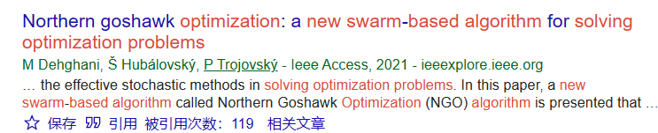

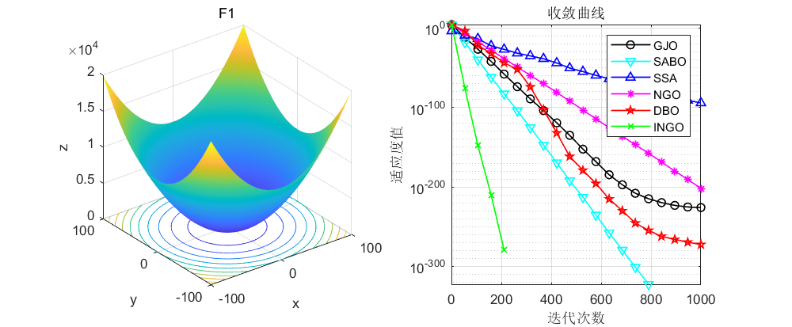
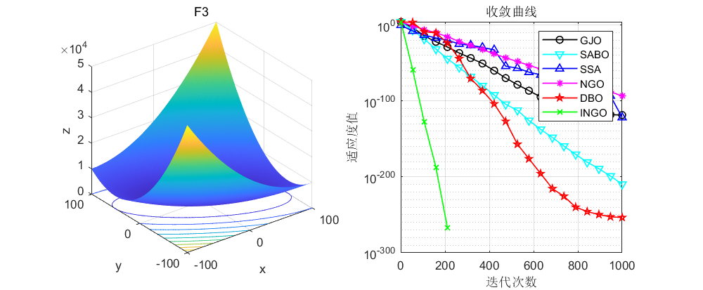
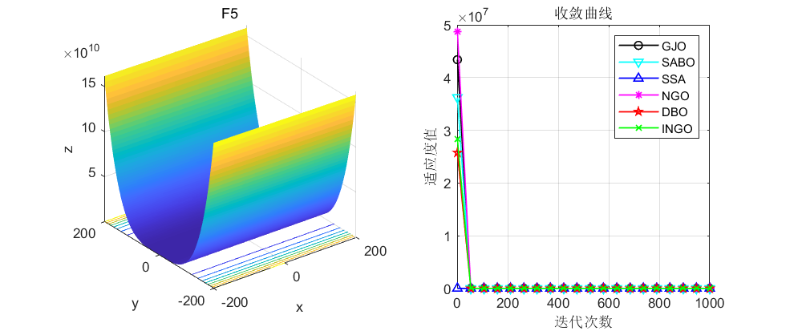
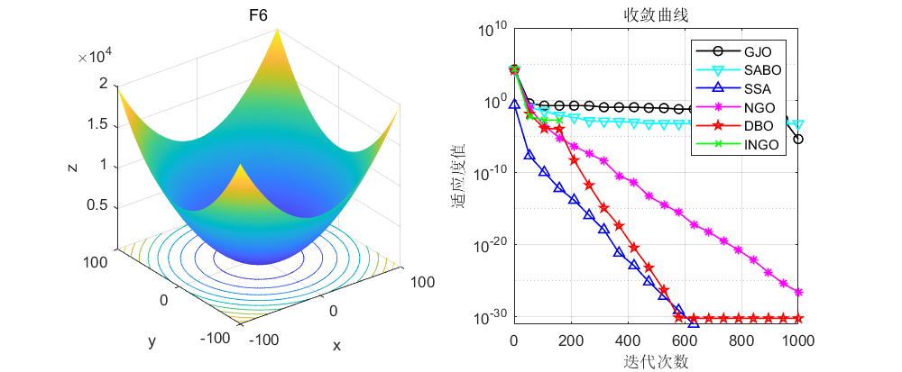
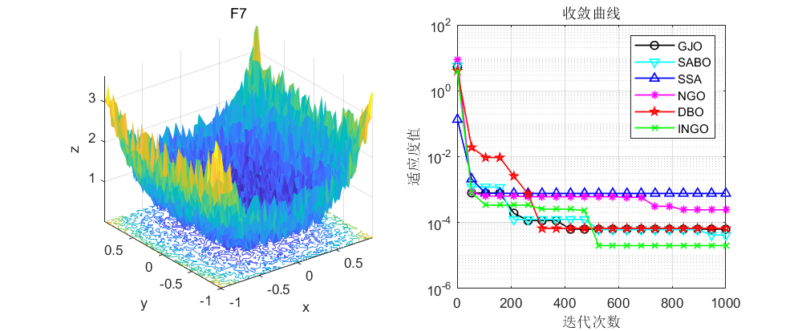
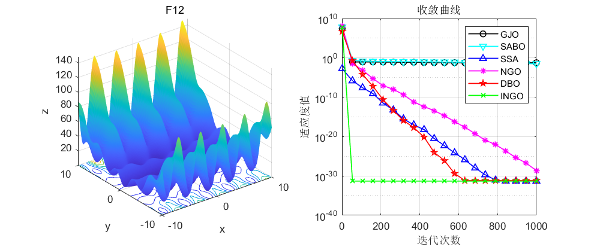
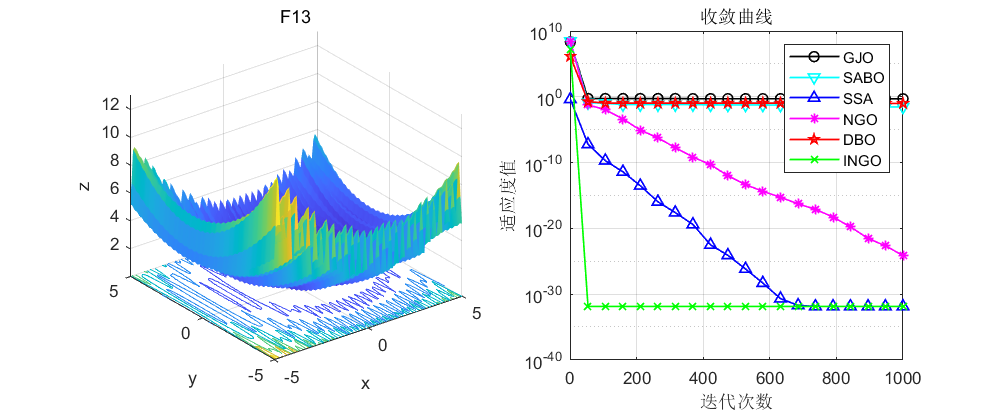
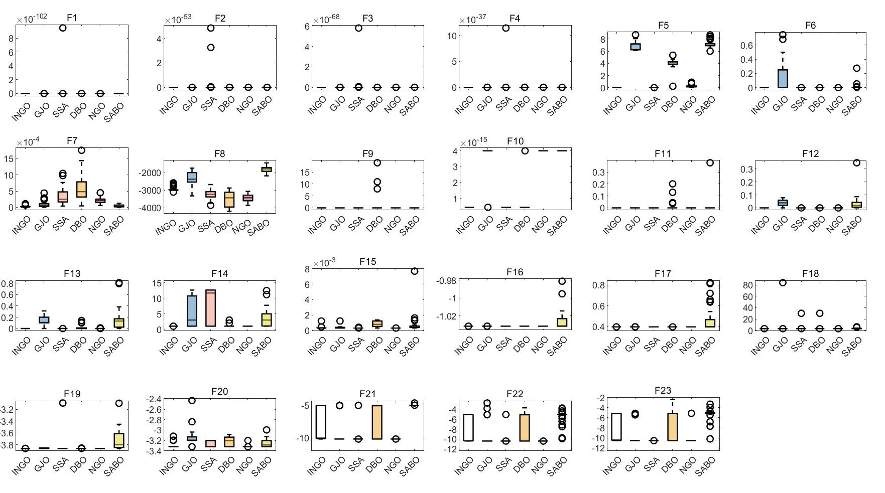
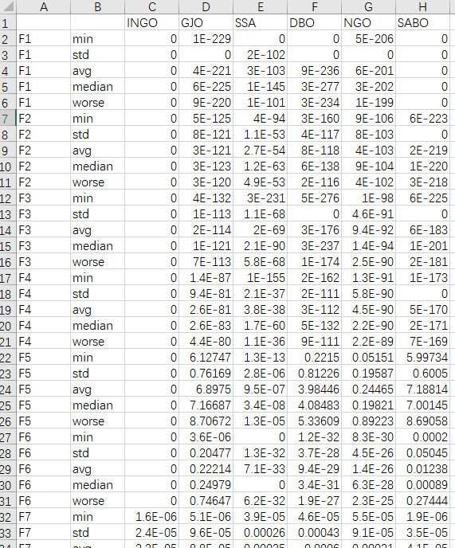
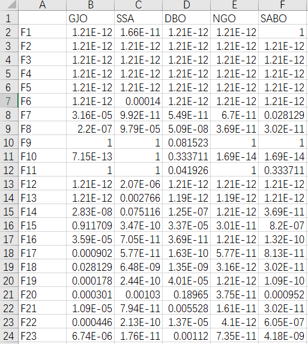

<!-- PAYMENT_BLOCK -->

## Get this dataset

- Payment link (Stripe): [Buy now](https://buy.stripe.com/3cs8yP7sY87d0vu9AB)
- Payment QR code: 

<!-- /PAYMENT_BLOCK -->
